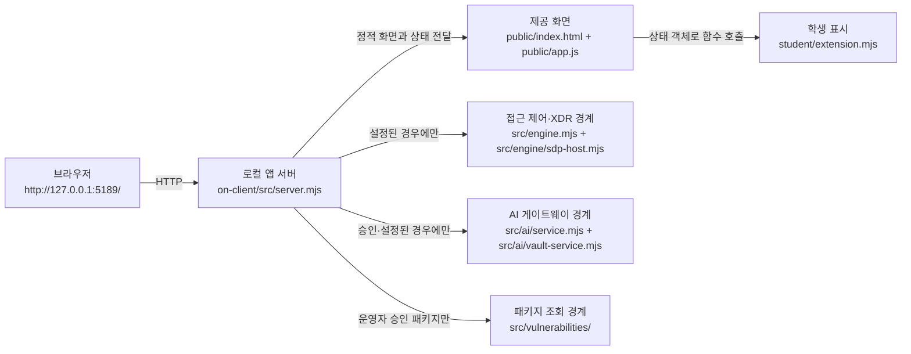

# 방어회방어전 학생용 실행 설명서와 시스템 구성도

## 1. 목적과 확인 범위

방어회방어전은 사용자가 자신의 로그인 상태, 업무 앱 접근 판정, 보안 기록과 보호 상태를 확인하는 로컬 보안 Agent 화면이다. 이 문서는 다른 사람이 실제 프로젝트 위치에서 로컬 앱 서버를 실행하고, 제공 코드와 학생 작성 코드의 경계를 확인할 수 있도록 작성했다.

2026-11-05에 새 Windows PowerShell 프로세스에서 `-NoNativeHost`로 로컬 실행을 확인했다. 로컬 서버의 HTTP 응답과 화면 원문은 확인했지만 접근 제어·XDR 시스템, AI 게이트웨이, 실제 OSV 외부 조회, 유료 AI 요청, 보안 조치 실행은 확인하지 않았다.

## 2. 작업 위치와 필요 프로그램

Git 최상위 폴더는 다음 위치다.

```text
C:\Users\User\Desktop\ALEPH · BYTE BACK\ALEPH-BYTE-BACK---jh
```

앱을 실행할 때 PowerShell을 여는 위치는 그 아래의 앱 폴더다.

```text
C:\Users\User\Desktop\ALEPH · BYTE BACK\ALEPH-BYTE-BACK---jh\on-client
```

| 항목 | 프로젝트 기준 | 2026-11-05 직접 확인한 환경 | 확인 결과 |
|---|---|---|---|
| 운영체제 셸 | Windows PowerShell | Windows PowerShell 5.1.26100.9711 | 실행 확인 |
| Node.js | `package.json`의 `24.19.0`; 실행 도구는 22~24 허용 | v24.21.0 | 경고 후 실행 확인 |
| npm | `npm start`, `npm run demo`, `npm run check`에 사용 | 11.19.0 | 버전만 확인 |
| Git | 커밋과 제출에 사용 | 2.55.0.windows.5 | 버전만 확인 |
| 브라우저 | `http://127.0.0.1:5189/` 접속 가능 브라우저 | 제품과 버전 미확인 | HTTP 응답만 확인 |

외부 npm 의존성은 없으며 현재 저장소에 `package-lock.json`과 `node_modules`가 없다. 따라서 이 실행에는 `npm install`을 사용하지 않았다.

## 3. 폴더 구조와 코드 경계

```text
ALEPH-BYTE-BACK---jh/                 Git 최상위 폴더
├─ student/extension.mjs              제출 검토용 학생 파일 복사본
└─ on-client/                         실제 실행 앱 폴더
   ├─ package.json                    실행 명령과 Node.js 기준
   ├─ .env.example                    비밀 없는 설정 항목 예시
   ├─ tools/start-alekov.ps1          실행 전 버전·폴더·포트 확인 및 서버 시작
   ├─ public/index.html               제공 화면과 버튼
   ├─ public/app.js                   제공 API 호출, 상태 관리, 학생 함수 호출
   ├─ src/server.mjs                  127.0.0.1 로컬 HTTP 서버와 API 경계
   ├─ src/engine/                     접근 제어·XDR 연동 경계
   ├─ src/ai/                         AI 게이트웨이 호출 경계
   ├─ src/vulnerabilities/            lockfile·설치 메타데이터·OSV 조회 경계
   ├─ student/extension.mjs           실행 화면이 읽는 학생 표시 함수
   └─ docs/STUDENT_RUNBOOK.md         이 문서
```

`public/app.js`는 `/student/extension.mjs`를 불러오며, `src/server.mjs`는 이 URL을 `on-client/student/extension.mjs`에 연결한다. 현재 Git 최상위의 `student/extension.mjs`와 실행본은 `renderEvents`, `renderStatus` 구현 상태가 다르다. 실제 화면 확인은 `on-client/student/extension.mjs`를 기준으로 해야 한다.

## 4. 실행, 종료, 재실행

### 4.1 PowerShell 열기

파일 탐색기에서 다음 폴더를 연다.

```text
C:\Users\User\Desktop\ALEPH · BYTE BACK\ALEPH-BYTE-BACK---jh\on-client
```

주소 표시줄에 `powershell`을 입력하고 Enter를 누른다. 열린 창에서 다음 명령으로 현재 위치를 확인한다.

```powershell
Get-Location
```

출력 경로의 마지막 폴더가 `on-client`인지 확인한다.

### 4.2 확인한 로컬 실행

다음 명령은 계정 연결 설정 없이 로컬 화면과 서버만 확인한다.

```powershell
powershell -NoProfile -ExecutionPolicy Bypass -File .\tools\start-alekov.ps1 -NoNativeHost
```

2026-11-05에 확인한 정상 시작 신호는 다음 세 줄이다. 설치된 Node.js가 수업 기준과 다르면 그 전에 버전 참고 문구가 표시될 수 있다.

```text
케셰브 연결 확인: http://127.0.0.1:5189
케셰브가 켜졌습니다. 브라우저에서 http://127.0.0.1:5189/ 을 여세요.
서버가 응답한 것만 확인했습니다. AI 연결 상태는 화면에서 따로 확인해 주세요.
```

브라우저에서 다음 공개 가능한 로컬 주소를 연다.

```text
http://127.0.0.1:5189/
```

이 실행에서 HTTP 200과 `보호 현황`, `업무 앱`, `보안 기록`, `설치 패키지 조회`, `현재 API 연결 점검`, `도움정보 불러오기` 문구를 확인했다. 이는 로컬 서버가 응답했다는 뜻이며 외부 시스템 연결 성공을 뜻하지 않는다.

### 4.3 운영 연결용 기본 명령

제공 실행 도구의 기본 명령은 다음과 같다. 이 명령은 계정 연결용 로컬 설정을 준비할 수 있다. 2026-11-05 확인에서는 외부 연결을 피하기 위해 실행하지 않았으므로 운영 연결 결과는 미확인이다.

```powershell
powershell -NoProfile -ExecutionPolicy Bypass -File .\tools\start-alekov.ps1
```

접근 제어·XDR 연동에 필요한 `-SdpHostConfig`와 AI 계정 연결은 운영자가 준비한 설정과 승인 절차가 있을 때만 사용한다. 설정 파일의 내용, 키, 토큰, 비밀번호는 이 문서나 Git에 기록하지 않는다.

### 4.4 종료와 재실행

1. 실행 중인 PowerShell 창에서 `Ctrl+C`를 누른다.
2. 브라우저에서 `http://127.0.0.1:5189/`이 더 이상 열리지 않는지 확인한다.
3. 같은 `on-client` 폴더에서 4.2 또는 운영자가 안내한 4.3 명령을 다시 실행한다.
4. 정상 시작 신호를 다시 확인한 뒤 브라우저를 새로 고친다.

2026-11-05 확인에서는 `Ctrl+C` 후 5189 포트의 수신 프로세스가 없음을 확인했다.

## 5. 시스템 구성도



글로 읽으면 흐름은 다음과 같다.

1. 브라우저는 공개 인터넷 주소가 아닌 `127.0.0.1:5189`의 로컬 앱 서버에 요청한다.
2. 로컬 서버는 제공 화면과 실행본 `on-client/student/extension.mjs`를 전달한다.
3. 제공 `public/app.js`가 API 요청과 상태 변경을 담당하고, 학생 함수에는 표시할 상태 객체만 전달한다.
4. 접근 제어·XDR 데이터는 SDP 설정이 있을 때 서버의 엔진 경계를 거친다. 이번 실행에서는 연결하지 않았다.
5. AI 요청은 계정·앱 권한과 게이트웨이 설정이 확인된 경우 서버의 AI 경계를 거친다. 공개 가능한 원격 URL은 현재 설정 견본에 없으며 이번 실행에서는 연결하지 않았다.
6. 설치 패키지 조회는 운영자가 프로젝트 경로와 공개 패키지 허용 목록을 설정한 경우에만 lockfile과 설치 메타데이터를 대조해 OSV 조회 경계를 사용한다. 이번 저장소에는 `package-lock.json`이 없어 실제 조회를 확인하지 않았다.

## 6. 제공 코드와 학생 작성 함수

| 구분 | 실제 파일·함수 | 입력 또는 책임 | 현재 확인 상태 |
|---|---|---|---|
| 제공 코드 | `public/app.js`, `src/server.mjs` | 버튼 이벤트, API 요청, 응답 검증, 상태 관리, 학생 함수 호출 | 코드 확인, 로컬 HTTP 확인 |
| 학생 작성 | `renderIdentity({ me, devices, sessions })` | 현재 계정·기기·세션의 로딩·오류·결과 표시 | 코드 확인, 실제 연결 데이터 미확인 |
| 학생 작성 | `renderDecision({ status, mode, data, error, appId })` | `idle/loading/error/ok` 및 접근 판정 표시 | 코드 확인, 실제 판정 미확인 |
| 학생 작성 | `renderEvents({ status, mode, data, error })` | 보안 기록, XDR 기록, 필터와 상세 표시 | 실행본 코드 확인, 실제 XDR 미확인 |
| 학생 작성 | `renderStatus({ devices, sessions, notifications, diagnostics, mode })` | 기기·세션·알림·도움정보 상태 표시 | 실행본 코드 확인, 실제 연결 데이터 미확인 |
| 학생 작성 | `renderVulnerabilities({ status, mode, data, error })` | 전체 조회 상태, 정확한 버전, 출처, 취약점 ID 표시 | 문법·모의 입력 확인, 실제 OSV 미확인 |
| 학생 작성 | `renderAiConnection({ status, mode, data, error, checkedAt, explanationAccepted })` | AI 연결 점검과 오류별 안내 표시 | 코드 확인, 실제 AI 연결 미확인 |
| 학생 작성 | `renderExplanation({ event, explanation, checkedAt })` | 선택 사건의 AI 설명과 근거 연결 표시 | 코드 확인, 실제 AI 설명 미확인 |
| 학생 작성 | `renderAction({ status, event, actionId, target, receipt, observation, message, confirmationExpiresAt, error })` | 준비·처리·결과 상태와 효과 관측 표시 | 코드 확인, 실제 보안 조치 미실행 |

학생 함수는 화면 표시만 담당한다. API 요청, 인증, AI 호출, 조치 실행은 제공 `public/app.js`와 `src/server.mjs`의 경계에 있으며 학생 화면이 임의로 전송하지 않는다.

## 7. 장애 상황별 확인 순서

| 상태 또는 오류 | 먼저 확인 | 다음 확인·복구 | 성공으로 판단하지 않는 항목 |
|---|---|---|---|
| `앱 폴더가 아닙니다`, `시작 틀 폴더가 아닙니다` | `Get-Location`의 마지막 폴더가 `on-client`인지 확인 | 실제 `on-client`에서 실행 명령을 다시 입력 | 다른 폴더에서 뜬 임의 서버 |
| Node.js 버전 안내 또는 거절 | `node --version` 확인 | Node.js 22~24를 사용하고 새 PowerShell에서 재실행; 수업 기준은 24.19.0 | 버전 확인 전 실행 추정 |
| `포트 5189` 사용 중 | 기존 앱 서버가 이미 열렸는지 브라우저로 확인 | 기존 프로세스를 임의 종료하지 않고 `-Port 5190`으로 실행 후 `http://127.0.0.1:5190/` 사용 | 다른 프로그램의 응답 |
| `ENGINE_NOT_CONNECTED` | 로컬 서버가 켜졌는지와 실행 옵션 확인 | 운영자에게 SDP 설정과 권한 확인 후 직접 다시 불러오기 | 연결 없음 상태를 정상 판정으로 표시 |
| `ON_AI_PROVISIONING_PENDING`, `SUBJECT_SCOPE_UNVERIFIED` | 계정 연결과 앱 승인 상태 확인 | 담당자에게 현재 계정 매핑과 앱 권한 확인 | 권한 준비 중을 AI 연결 성공으로 표시 |
| `WB_CLCO_AUTH_REQUIRED`, `WB_CLCO_ACCESS_BLOCKED` | 계정 연결을 다시 확인 | 담당자에게 앱 권한·차단 상태 확인 | 키나 토큰을 문서·화면에 입력 |
| `WB_CLCO_RATE_LIMITED`, `WB_CLCO_TIMEOUT`, `WB_CLCO_NETWORK_ERROR`, `WB_CLCO_SERVER_UNAVAILABLE` | 인터넷과 로컬 앱 실행 상태 확인 | 잠시 뒤 화면의 점검 버튼을 직접 다시 누름 | 자동 재시도 또는 이전 결과 재사용 |
| 패키지 `not_configured`, `not_checked`, `unverifiable` | 운영자 설정 여부와 화면의 원래 상태값 확인 | 운영자가 대상 경로·허용 패키지를 준비한 뒤 `설치 패키지 조회`를 다시 누름 | 미조회·확인 불가를 취약점 없음으로 표시 |
| 조치 `unknown`, `ACTION_TIMEOUT`, `ACTION_RESULT_UNVERIFIED` | 사건·요청 식별자와 현재 표시 상태 확인 | `원천 결과만 재조회`로 결과만 다시 확인 | ACK 또는 불명 상태를 효과 확인으로 표시 |

화면 오류 문구가 이 표에 없으면 `도움정보 불러오기`로 안전한 진단 정보만 확인하고, 비밀값이나 설정 파일 원문 없이 담당자에게 오류 코드와 확인 시각을 전달한다.

## 8. 확인한 기능과 미확인 기능

| 증거 종류 | 결과 |
|---|---|
| 코드 확인 | 실제 실행 경로, `package.json`, 실행 스크립트, 서버 라우팅, 버튼 원문, 학생 함수 입력 계약을 확인했다. |
| 문법·모의 입력 확인 | 앞 단계에서 두 학생 파일의 문법과 `renderVulnerabilities` 상태별 모의 입력을 확인했다. |
| 로컬 실행 확인 | 새 PowerShell 프로세스에서 `-NoNativeHost`로 시작, HTTP 200, 주요 화면 문구, 학생 모듈 HTTP 200, `Ctrl+C` 종료와 포트 닫힘을 확인했다. |
| 실제 화면 조작 | 브라우저 UI를 직접 클릭하는 검사는 이번 단계에서 실행하지 않았다. |
| 접근 제어·XDR | 실제 SDP 설정·계정·데이터 연결을 확인하지 않았다. |
| AI 게이트웨이 | 실제 권한, 모델 목록, AI 설명 응답을 확인하지 않았다. 유료 AI 요청도 실행하지 않았다. |
| 패키지·OSV | 실제 `package-lock.json`, 설치 메타데이터, 외부 OSV 응답을 확인하지 않았다. |
| 보안 조치 | 준비·실행·원천 효과를 확인하지 않았고 임의 실행하지 않았다. |

## 9. 비밀 설정과 제출 경계

`.env.example`에는 공개 가능한 설정 항목 이름만 있으며 실제 키·토큰·비밀번호를 넣지 않는다. 실제 비밀값은 Git 제출에서 빠지는 `.env` 또는 운영자가 지정한 보호 설정에만 둔다. 이 문서는 단계 제출을 실행하거나 통과를 주장하지 않으며, 커밋 주소와 40자리 커밋은 문서 작성과 검증이 끝난 뒤 실제 Git 결과로 확인한다.
